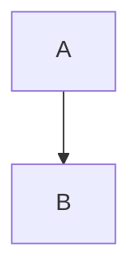

# Draft architecture

Follow the field contract in `references/architecture-contract.md`.

## Procedure

1. Read the approved PRD and approved design from the ticket (summary, description, PRD comment, design comment). Include any rejection notes from a prior `architecture_review`.
2. Derive **components** that cover the design screens/flows and PRD acceptance criteria. Do not invent product goals outside the PRD.
3. Define **boundaries** (ownership, trust, data, and interface edges between components).
4. Build a **dependency graph**: directed edges showing what depends on what (build/runtime). Prefer a mermaid `flowchart` or adjacency list that implementers can follow.
5. Put unknowns and PRD/design gaps in **open questions** instead of guessing product or UX intent.
6. Validate mentally against the contract before posting.

## Output shape (before Jira post)

```markdown
## Architecture

### Summary
...

### Components
| Component | Responsibility | Notes |
| --- | --- | --- |
| ... | ... | ... |

### Boundaries
- ...

### Dependency graph


### Open questions
- ...
```
